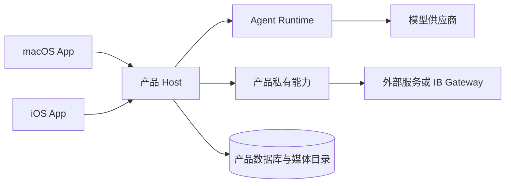

# Yolo Agents 架构

本文只记录稳定架构、数据边界和安全约束。当前进度、阻塞和下一步统一见 [ROADMAP](ROADMAP.md)；历史调研和验收快照位于 [`archive/`](../archive/)；开发协作规则见 [AGENTS.md](../AGENTS.md)。

## 产品与仓库边界

`yolo-agents` 是共享框架与多个产品的 monorepo：

- `yolo-trade`：交易助手，私有持有 IBKR、账户事实、订单、风控和交易状态。
- `yolo-beni`：日常生活助手，私有持有个人偏好、生活数据和专属集成。
- `packages/`：只存放已被多个产品真实复用的协议、运行时、Swift SDK 和通用 UI。

产品身份必须在各自技术边界内只有一个来源：Python 使用产品模块，Swift 使用产品配置，Xcode 使用对应 `xcconfig`。共享层不得根据产品 ID、名称、目录或端口推断能力，也不得提供某一产品的默认地址、Keychain 标识或 Bundle ID。

## 总体结构



- `packages/core-python/`：认证、会话、消息、媒体、事件、Host 和通用 Agent Runtime。
- `packages/protocol/`：跨语言 API、JSON 模型和兼容规则。
- `packages/sdk-swift/`：设备配对、认证、网络、同步和本地缓存。
- `packages/ui-swift/`：通用 SwiftUI 会话、账号、连接和功能入口。
- `agents/<agent>/runtime-python/`：产品私有运行时、能力、配置和测试。
- `apps/<agent>/`：产品私有 Swift 模块、macOS/iOS 入口和 Xcode 工程。

## 身份、授权与数据隔离

每个 Agent 使用独立的应用身份、数据目录、数据库、媒体目录、Skills、模型状态、OAuth 注册、Keychain 命名空间和客户端缓存。Mac 与 iOS 可以连接同一 Agent Host，但不能继承另一个产品或 ChatGPT/Codex 宿主的授权。

默认数据目录为：

```text
~/Library/Application Support/YoloAgents/<agent-id>/
```

非空未标记目录必须拒绝接管。旧身份数据只能由对应产品通过限定来源、备份、校验和回滚的一次性迁移处理；共享 Host 不猜测、不自动移动，也不补写归属标记。

第三方插件只有在发布方提供公开、可移植且文档化的接口与认证方式时才可评估。宿主 Cookie、OAuth/token、内部插件标识、私有端点、抓包重放和 UI 自动化代理均不属于支持方案。

## 通信与持久化

客户端使用 HTTP JSON、认证 SSE 和持久事件游标：

- 在线回复通过 SSE 发送增量。
- 启动或断线后使用 REST 游标补齐，再恢复 SSE。
- 消息提交使用客户端 UUID 幂等，不自动重放不确定写请求。
- 每个 Agent 拥有一个长期主会话和多个可归档任务会话。
- 模型上下文可以压缩，但产品消息、订单账本和审计记录不因此删除。

完整契约见 [通信协议 v1](../packages/protocol/COMMUNICATION_V1.md)，主会话与上下文设计见 [PRIMARY_CONVERSATION](PRIMARY_CONVERSATION.md)。

图片元数据存储在 SQLite，原始文件位于产品数据目录下的 `media/YYYY/MM/<sha256>.<ext>`。目录和文件权限分别为 0700/0600；读取时复核路径、文件类型、大小和 SHA-256。月份目录用于定位与运维，不代表可以绕过消息引用直接删除。

## Agent Runtime

共享 Runtime 支持显式 `demo`、`pydantic`、`chatgpt` 和 `codex` 模式：

- `demo` 不调用真实模型或外部服务。
- `pydantic` 使用 PydanticAI Core 与官方 Harness。
- `chatgpt` 使用当前 Agent 自己的 Sign in with ChatGPT 授权。
- `codex` 只作为显式兼容模式，不读取或复制 Codex 登录凭据。

Runtime 不直接持有产品权限。产品入口通过通用能力声明、工具工厂、回调或依赖注入接入私有能力。模型状态和产品消息分开持久化；恢复已完成结果不得重放模型或工具。

历史选型证据见 [PydanticAI 调研](../archive/RESEARCH_PYDANTICAI.md) 和 [ChatGPT Provider 方案](../archive/CHATGPT_PROVIDER_PLAN.md)。

## YoloTrade 与 IBKR

YoloTrade 使用本机 IB Gateway + TWS API + 私有 Python 适配层。Gateway 负责登录和券商会话，YoloTrade 负责目标账户校验、状态读取、程序风控、订单、对账和恢复。

首批执行范围固定为 Paper、美股 `STK/SMART/USD`、普通 BUY/SELL、正整数数量、`LMT/DAY`、不含盘前盘后。Live 没有执行路径。

AI 辅助草稿与直接快速下单是两个入口；快速下单不调用模型。两条路径在程序预检后共用同一套订单账本、What-if、确认和执行门禁：

```text
AI 路径：结构化草稿 → 程序预检 → AI 审核 ┐
直接路径：精确合约 + 手填限价 → 程序预检 ──┴→ What-if → 用户明确确认
→ Mac Host 提交前复核 → 单次提交 → 状态跟踪与对账
```

关键约束：

- 环境和目标账户必须显式配置，不根据端口或账户顺序猜测。
- 对账未完成、数据过期、权限不明或状态未知时失败关闭。
- 意图、版本、确认和幂等请求先落库，再调用券商。
- 提交超时不能解释为未成交；未知订单不自动重发。
- 外部订单默认只同步和计入占用，不自动绑定、修改或撤销。
- Mac 管理设备可以单独授权或撤销已配对 iPhone 的 Paper 交易权限；未授权 iPhone 仍可只读。每次操作都重新认证，确认与提交绑定同一设备；券商调用只由 Mac Host 执行。

订单契约见 [Paper 订单](../agents/yolo-trade/PAPER_ORDERS.md)，Gateway 运维见 [自动恢复手册](../agents/yolo-trade/IBKR_GATEWAY_AUTOMATION.md)。

IB Gateway/TWS API 的认证、自动重启、会话冲突和订单可见范围以官方规则及账户实测为准。自动重连只恢复连接和完整对账，不放宽订单授权，也不允许重放未知请求。

## Apple 客户端

两个产品复用 Swift SDK 和通用 UI，但由私有根视图注入身份和功能。macOS 支持账号管理和产品管理操作；iOS 使用脱敏状态和受限能力。

iOS 最低版本为 26，使用系统 Liquid Glass。共享 `AgentActionDock` 只渲染产品注入的通用入口，不根据产品身份开启交易或生活能力。macOS 最低版本为 14，继续使用原生侧边栏和工具栏。

## 文档职责

- [README](../README.md)：项目入口、启动方式和导航。
- [AGENTS](../AGENTS.md)：开发边界与多会话协作规则。
- 本文：稳定架构和安全约束。
- [ROADMAP](ROADMAP.md)：唯一的当前状态和未完成任务。
- 产品 README：模块、配置、运行与构建方法。
- `archive/`：已完成方案、旧任务快照和历史调研，不作为当前要求。
