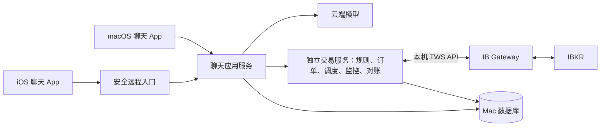

# IBKR AI 助手：需求与架构

更新日期：2026-10-28

状态：Agent/产品存储、聊天通信 API 与 Apple 客户端首版已完成本机验收；Codex 真实聊天和 Mac UI 已实测。IBKR Paper 股票限价单的后端状态机、Mac 明确确认和 iOS 只读界面已实现，Live 强制关闭。本机 Gateway 已安装并登录 Paper；真实可写连接仍被 Gateway 的 Read-Only API 阻止，尚未发出任何模拟订单。

本文是当前需求与设计的唯一依据；开发任务、进度和验收统一见 [TODO.md](TODO.md)。`../archive/` 中的旧调研仅保留证据，不作为当前选型或开发要求。下文区分已确认需求、设计方向、官方规则和待实测边界。

## 1. 产品目标与范围

供个人使用、常驻 Mac 的对话式 IBKR 助手，已确认需求：

- Mac 端聊天、切换会话，聊天及工具记录存数据库。
- 查询账户、持仓、挂单和行情；下单前审核合理性，不合理时拦截并解释。
- 支持提前授权的定时订单，用户乘机或客户端离线时由后台执行检查。
- 支持股票和具体期权合约的价格监控、提醒。
- 用户继续使用 IBKR 官方客户端交易，系统按已验证范围同步实际状态。
- iPhone 连接 Mac，聊天与历史互通，可查看审核、执行结果和提醒。首版不开放 iPhone 确认订单、提交订单或授予可执行交易计划的权限。

客户端沿用自建 SwiftUI macOS＋iOS 的方向，共享模型、认证和同步组件。当前不做量化策略、回测、全市场历史仓库、本地大模型、独立手机交易控制台；价格提醒不自动转成订单。

股票限价单是首批执行验证对象。已有期权持仓仍要同步并计入风险；单腿期权交易后续单独验收，多腿组合、Greeks 和行权/指派操作按需求扩展。

## 2. 服务分层与数据归属

- **聊天应用服务**负责会话、模型调用、AI 审核和受控工具接口；主 Agent 已选 PydanticAI Core＋官方 Harness，记忆/检索/压缩方案见 [Agent 方案](RESEARCH_PYDANTICAI.md)。当前同时提供本地演示、PydanticAI 和 Codex app-server 模式；Codex 复用 Mac 上受管 ChatGPT 登录且已完成真实模型验收，PydanticAI 供应商仍需单独配置与验证。
- **独立交易服务**统一持有 IBKR 连接，负责账户事实、程序风控、授权校验、订单、定时任务、行情监控和恢复。当前已实现显式环境配置、Paper 启动读取、What-if、订单状态/事件、独立账本及 Mac 管理设备确认；Live 强制关闭。当前 Host 与聊天仍同进程，独立守护、自动重连和跨重启主动对账属于后续工作。 Paper 专用双端模型、请求和界面归属 `apps/trading-agent/client-swift/`，共享 SDK/UI 只提供通用传输和功能入口。
- **IB Gateway**是官方程序，管理券商登录和连接。第一版均在同一台 Mac 上运行，交易服务内部先按模块划分。
- **数据库**保存会话、消息、工具调用、订单意图及版本、授权、审核、券商订单/成交、自动化任务和审计。券商实际状态是对账依据；模型摘要不作为交易账本。
- Agent 只能调用受控业务入口，不直接连接券商或修改风控配置。立即订单、定时任务和其他入口共用同一执行规则。
- 手机不持有券商凭据、不直接连接 Gateway；使用设备认证、加密连接和可撤销凭据。会话用服务端游标增量同步，手机离线缓存以服务端为准。
- 领域模型、工具接口和客户端事件协议由应用定义，框架对象留在适配层内部。首版产品存储采用 SQLite WAL，客户端采用 HTTP JSON＋持久事件游标；在线回复使用认证 SSE，启动和断线恢复使用 REST 增量补齐。协议见 [通信 v1](../packages/protocol/COMMUNICATION_V1.md)。外网访问方案、可信证书和长期恢复仍须实测。

## 3. IBKR 接入结论

### 3.1 接入路线（当前设计方向）

优先验证 **IB Gateway + TWS API + 独立 Python 薄适配服务**。TWS 也能提供该 API；长期后台运行优先考虑 Gateway。账户在 Gateway 登录界面认证，Python 程序连接其本机接口。[官方连接架构](https://www.interactivebrokers.com/docs/tws-api/doc/architecture/the-trader-workstation/the-ib-gateway)

| 客户端/框架 | 当前定位 |
| --- | --- |
| `ib_async` | 首选联调候选，提供异步调用、行情与交易事件、账户同步；仍需自建持久化、授权和恢复流程。 |
| 官方 Python API | 对照和替代方案；官方从 TWS API 10.40 起提供 `TWSSyncWrapper` 同步封装。 |
| NautilusTrader | 保留为执行与对账候选；若薄服务开发和维护成本过高，再用同一验收场景比较。 |
| WealthLens / 其他旧候选 | 仅作参考，不作为账户或执行核心依赖。 |

`ib_async` 是第三方协议实现，不要求同时安装官方 `ibapi`。库内同步不等于本系统已实现重启恢复；正式选择须固定 Python、客户端库和 Gateway 版本并联调。[ib_async 文档](https://ib-api-reloaded.github.io/ib_async/)、[官方同步封装](https://www.interactivebrokers.com/docs/tws-api/sync-doc/introduction)

Client Portal Gateway 需要浏览器认证，官方要求每日重新认证且不支持自动化该认证过程，因此暂不作为常驻服务首选。这项限制不能泛化到所有 Web API/OAuth 接入方式。[官方 FAQ](https://www.interactivebrokers.com/docs/web-api/authentication/cpgw/client-portal-gateway-faq)

### 3.2 初次连接与 Paper 执行门槛

| 项目 | 接入约定 |
| --- | --- |
| 环境与账户 | 登录 Paper Trading，显式配置目标账户并校验返回账户；不取默认第一个账户。 |
| 地址与端口 | 本机 `127.0.0.1`；Gateway 默认模拟盘 `4002`、实盘 `4001`，TWS 默认模拟盘 `7497`、实盘 `7496`，以实际配置为准。端口不作为环境的唯一判断依据。 |
| API 权限 | 只读联调时保持 `Read-Only API`；验证 Paper What-if/订单前必须确认登录为 Paper，再取消该勾选。服务端仍以显式 Paper 配置、目标账户、启动读取和 Mac 权限逐层阻断。 |
| Client ID | 固定、不冲突的非零编号起步；Master Client 范围另测，不为读取人工订单自动启用 client ID 0 绑定。 |
| 行情 | 核对股票/期权订阅，明确实时、延迟、冻结状态，及 bid/ask/last/mid 口径和时间。 |

首次登录由用户完成，凭据不进入文档、仓库或日志。本机已安装并登录 Paper Gateway，4002 端口可达；现有 Read-Only API 会拒绝可写客户端的开放/已完成订单启动读取，因此在取消该设置前执行门槛保持关闭。上述端口和设置依据见 [官方配置说明](https://www.interactivebrokers.com/campus/trading-lessons/installing-configuring-tws-for-the-api/)。

### 3.3 登录态、保活和重新认证（官方规则核查：2026-10-24）

连接分成两层：**交易服务 → Gateway 的本机连接**，以及 **Gateway → IBKR 的已认证会话**。券商登录态由 Gateway/TWS 维护，TWS API 客户端没有可用来无限续期登录的刷新令牌。心跳用于发现异常，不能延长认证周期。

- 在 `Global Configuration → Lock and Exit` 启用 **Auto restart**，设置每天重启时间。正常条件下，工作周内可每日自动重启而不重新输入凭据；周末重置后通常需人工重新认证。[官方自动重启 FAQ](https://www.interactivebrokers.com/docs/third-party-integrations/general-third-party-frequently-asked-questions)
- 这是每周认证周期，不是每次登录起保证有效 168 小时。用户指南写明每周日美东 01:00 使安全令牌失效，对应北京时间夏令时 13:00、冬令时 14:00；另一个 API 页面使用“周一开始认证周期”的表述。将周末重认证作为运维窗口，具体行为以所用版本、账户和实际登录状态为准，不据此计算保证有效期。[用户指南](https://www.ibkrguides.com/traderworkstation/auto-restart-considerations.htm)、[API 认证说明](https://www.interactivebrokers.com/docs/tws-api/doc/tws-settings/daily-weekly-reauthentication)
- 其他登录、安全令牌撤销、休眠、断电、系统更新或异常退出可能提前打断自动恢复；普通重开 Gateway 不能当作官方计划内自动重启。

| 事件 | 恢复处理 |
| --- | --- |
| 交易服务重启；Gateway 登录仍有效 | 自动重连，重新同步并对账。 |
| 短暂断网；认证仍有效 | 等待/重试连接，恢复后核对数据并按需恢复订阅。 |
| Gateway 正常执行每日自动重启 | 等待接口恢复，再连接和对账；期间不提交新单。 |
| 周期认证失效、令牌撤销或会话冲突 | 标记需要人工处理，暂停新执行并通知用户。 |
| Mac 重启或 Gateway 异常退出 | 检查 Gateway 是否需要登录，不保证无人干预恢复。 |

人工重新认证：在 Mac 的 Gateway 输入用户名/密码、核对模拟/实盘，按要求完成 IB Key 等二次认证；交易服务随后自动重连，核对账户、持仓、挂单和成交，确认数据完整后再开放执行。手机 IB Key 批准的是 Mac 登录，不要求进入手机交易会话。[IB Key 官方流程](https://www.ibkrguides.com/securelogin/sls/using-two-factor.htm)

外出时可用事先配置的安全远程桌面操作 Gateway，再在手机完成认证；通知不代替发起登录。不能承诺用户无法完成认证时仍执行定时订单。

### 3.4 多端登录、外部订单与恢复边界

同一用户名不能同时维持多个交易应用的交易会话。额外用户名可用于并行登录，但不是新资金子账户，权限和行情订阅需单独核对。官方指出同用户名登录 Client Portal 可能影响 Gateway 后续自动重连；只读访问、交易会话和 IB Key 认证需分别验证。[多应用登录说明](https://www.interactivebrokers.com/docs/tws-api/doc/connectivity/logging-into-multiple-applications)、[Web API 会话说明](https://www.interactivebrokers.com/docs/web-api/authentication/sessions)

`reqAllOpenOrders` 读取可见挂单但不绑定。修改/撤销手工 TWS 订单涉及 client ID 0 与绑定，绑定可能撤回重报并影响排队位置。Master Client、跨用户名和 IBKR Mobile 的实际可见范围仍待账户实测。[绑定规则](https://www.interactivebrokers.com/docs/tws-api/doc/orders/modifying-orders)、[Client ID 与 Master Client](https://www.interactivebrokers.com/docs/tws-api/doc/order-management/client-id-0-and-the-master-client-id)

本系统采用以下规则：

- 外部订单默认只同步展示、计入挂单占用，不自动绑定、修改或撤销；来源无法确认时标记未知。
- 数据保留账户、币种、带方向数量/市值、合约身份、时间和完整性。失败或缺失不能显示为零资金、空仓或示例资产。
- 启动、重连和定期查询结合在线事件对账；保存账户、`conId`、`clientId/orderId`、`permId`、成交标识映射，处理重复、乱序、迟到与更正。
- 当前状态恢复与完整历史恢复分开；API 历史窗口外的缺口明确标注，必要时评估报表补充，内部修正不得冒充真实成交。
- 提交超时或进程退出后，券商可能已接单甚至成交；先核对再决定后续状态，未知时阻止相关重复提交。
- 运行状态至少区分连接异常、重连、人工认证、对账中和数据就绪。数据就绪仍须通过权限、授权和订单规则才能下单。

以上路线已完成真实 Paper Gateway 的安装、登录、端口和只读连接检查，但尚未通过可写启动对账、真实 What-if 或订单验收；外部订单范围、行情权限、恢复和跨周认证见 [TODO.md](TODO.md) 的 M0/M2/M3。

## 4. 订单审核与执行规则

立即订单：**结构化草案 → 程序预检 → AI 审核 → 用户确认 → 执行前复核 → 提交 → 状态跟踪与对账**。

- 草案包含账户、唯一合约、方向、数量、类型、价格、TIF、时段和理由；关键字段缺失不得猜测。
- AI 输出 `APPROVE`、`REJECT` 或 `NEEDS_CONFIRMATION`，附依据、数据时间和有效期；失败、无法解析或过期不能视为通过，不能覆盖硬规则。
- 硬规则检查权限、数据完整/新鲜、购买力、持仓与挂单占用、限额/集中度、报价偏离/价差、时段和重复/冲突/未知请求。阈值由用户确定，示例不构成授权。
- 确认绑定订单版本与范围；关键参数改变后重审和确认。并发订单需账户级串行或额度预留，防止共同超限。
- 意图、授权和幂等键先落库，再调用券商；状态覆盖提交中、未知、接受、部分成交、成交、拒单、取消及竞争。提交成功不等于成交。
- 审计串联原始指令、版本、快照、模型/规则版本、审核、授权及券商事件；实盘与模拟盘使用独立配置和执行开关。

拦截仅对本系统入口有效；官方客户端直接提交的订单无法由我们事前阻止。暂停新执行或取消定时任务，也不等于撤销券商已接收的挂单。

## 5. 定时订单与价格监控

定时任务持久保存合约/账户、数量/金额/价格边界、时区、目标时间、窗口、过期、取消条件、预授权及审核记录。到点重取数据、重跑 AI 和硬规则；仅在仍为 `APPROVE`、授权有效且窗口内提交。必需条件不可用均不下单；过期不补发，未授权不顺延交易日。

默认先验证“Mac 到点重审后提交”。券商侧提前提交、到点激活的路径另行核验支持范围、托管位置、修改/撤销与授权语义；不能默认提供本地到点重新审核，选择该路径需独立验收。

价格监控支持股票及完整期权合约的高于/低于/上穿/下穿、有效时段、冷却、一次/重复、暂停与过期；条件和触发状态持久化，断流和旧报价不能触发新提醒。提醒写入关联会话，通知渠道另选；提醒与交易权限分开。

## 6. 部署与当前交付目标

原规划部署目标为 Mac mini M6、24GB/512GB，以实际设备和负载验收为准。后台需自动启动、避免休眠、限制日志/缓存增长，并备份数据库及必要配置；密钥受保护、日志脱敏。供电、网络、Gateway 会话、行情和云端模型均是运行依赖。

乘机前检查待执行任务、窗口是否跨每日重启/周末认证、电源/休眠、网络、服务、账户/行情和通知。提前登录不保证跨周末有效；认证失效且无人响应时暂停任务。

**当前已交付 Agent、Apple 聊天客户端、通信闭环和受控 Paper 订单首版。** Mac 将草稿、What-if、确认、提交和单笔撤单分开，iOS 只读；订单账本和 HTTP 幂等独立于聊天，Live 没有执行路径。下一步先取消 Gateway 的 Read-Only API，完成真实 Paper 启动对账，再用用户明确指定并确认的订单做 What-if/提交/成交/撤单验收；AI 审核、完整风控、主动恢复和定时订单仍在后续阶段。具体任务见 [TODO.md](TODO.md)。

## 7. 历史资料

- [TradingAgents 与研究工具调研](../archive/RESEARCH_TRADINGAGENTS.md)
- [NautilusTrader、订单同步与恢复调研](../archive/RESEARCH_NAUTILUSTRADER.md)
- [WealthLens 数据完整性与看板调研](../archive/RESEARCH_WEALTHLENS.md)
- [原共享会话](https://chatgpt.com/s/t_6adb5cc9145c8191abe2312130bd6987)

归档保留当时的版本、结论、来源和未完成事项，可能与当前范围不同；活跃任务以 TODO 为准。官方规则与源码证据不等于本系统已实现或实测通过。
