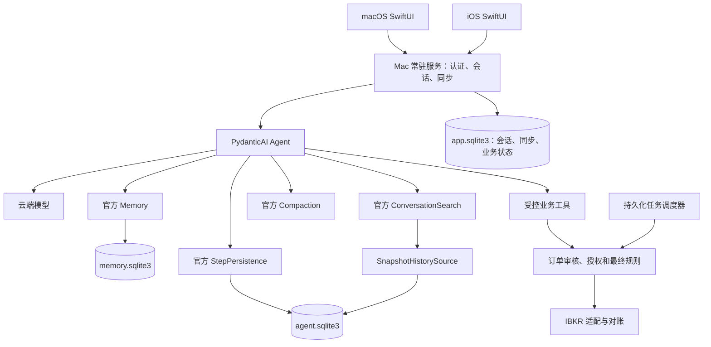

# PydanticAI Agent、长期记忆与历史对话检索方案

调研日期：2026-10-24（Asia/Shanghai）  
关联文档：[项目大纲](PROJECT_OUTLINE.md)、[开发任务](TODO.md)  
决策状态：**主 Agent 使用 PydanticAI；长期记忆、历史召回、上下文压缩和运行快照使用 Pydantic 官方组件。**  
验证范围：核对官方文档、PyPI 元数据、发布记录及固定版本源码；对历史检索的分词规则做了最小复现。未安装运行完整 PydanticAI，未调用云端模型，未连接 IBKR。本文中的架构、参数和实施顺序属于本项目设计，不能视为已实现能力。

## 1. 方案结论

采用 **PydanticAI Core＋Pydantic AI Harness**，按需组合官方 capability：

| 本项目需求 | 采用的官方能力 | 应用层仍需负责 |
| --- | --- | --- |
| 聊天、工具调用、结构化订单意图与审核 | `Agent`、依赖注入、Pydantic 输出模型、function tools | 业务工具、设备身份、账户权限、规则引擎 |
| 多轮会话保存和恢复 | `Conversation`、`ConversationTypeAdapter` | 数据库读写、会话归属、并发控制 |
| 运行记录、步骤快照、工具执行线索 | `StepPersistence`＋`SqliteStepStore` | 恢复决策、保存期限、交易结果对账 |
| 跨会话长期记忆 | `Memory`＋`SqliteMemoryStore` | 记忆政策、查看/纠错入口、数据访问控制 |
| Agent 主动检索历史对话 | `ConversationSearch`＋`SnapshotHistorySource` | 选择检索范围、保留历史、质量与规模验收 |
| 长对话上下文控制 | `SummarizingCompaction` 等官方策略 | 触发预算、费用限制、保留原始产品记录 |
| 等待用户确认并继续 | Deferred tools＋完整 `Conversation` | 确认卡片、服务端授权、订单版本和有效期 |
| 流式显示与排错 | 官方运行事件、OpenTelemetry／可选 Logfire | SwiftUI 事件映射、断线补齐、日志数据范围 |

**“使用官方”在这里指复用官方机制和存储适配器，不代表把聊天数据交给某个官方云端记忆服务。** SQLite 数据保存在 Mac；调用云端模型时，所选的上下文和工具结果仍会发送给模型供应商。

首版不增加其他记忆框架、向量数据库或独立 RAG 服务。官方组件已经覆盖记忆笔记、文本召回、压缩和快照；中文语义检索的不足单独记录，不能把 BM25 写成语义检索。官方 Harness 的定位与组合方式见 [Harness 文档](https://pydantic.dev/docs/ai/harness/)，状态分工见 [Persistence](https://pydantic.dev/docs/ai/core-concepts/persistence/)。

## 2. 核对的版本与维护位置

| 项目 | 本次核对结果 | 对实施的影响 |
| --- | --- | --- |
| PydanticAI Core | PyPI `pydantic-ai`／`pydantic-ai-slim` 为 **2.61.0** | 以此版本建立首轮验证基线 |
| Pydantic AI Harness | PyPI `pydantic-ai-harness` 为 **0.61.0** | 它是单独的官方包，不是安装 Core 后自动获得的全部能力 |
| 依赖关系 | Harness 0.61.0 精确依赖 `pydantic-ai-slim==2.61.0` | 两者一起升级和锁定 |
| Python | 上述包均要求 **Python ≥3.11** | 建议先用 Python 3.13，最终与 IBKR 适配器一起验证 |
| 固定源码 | `pydantic/pydantic-ai` 的 `v2.61.0`，提交 `dd82a00ae3ef9a5f147405153eb877221d74d1c7` | 本文源码判断不依赖持续变化的 main |
| 发布日期 | GitHub `published_at` 为 2026-10-24 03:13:40 UTC，即北京时间 11:13:40 | 发布标题虽写 2026-10-23，本文按实际发布时间记录 |
| Harness 维护仓库 | 旧的 `pydantic/pydantic-ai-harness` 已归档；当前代码在 Core 仓库的 `src/pydantic_ai_harness/` | 不再基于旧仓库搭建或引用旧 API |

依据：[Core 2.61.0 包元数据](https://pypi.org/pypi/pydantic-ai/2.61.0/json)、[Harness 0.61.0 包元数据](https://pypi.org/pypi/pydantic-ai-harness/0.61.0/json)、[v2.61.0 发布](https://github.com/pydantic/pydantic-ai/releases/tag/v2.61.0)、[当前 Harness 源码](https://github.com/pydantic/pydantic-ai/tree/v2.61.0/src/pydantic_ai_harness)、[旧仓库](https://github.com/pydantic/pydantic-ai-harness)。

Core 与 Harness 的稳定性承诺不同。Core 对 minor release 有更严格的兼容政策；Harness 仍采用 0.x，minor release 可以调整 API，并通过弃用提示和发布说明提供迁移指导。因此，依赖锁定、升级前恢复测试、数据库备份都应从第一阶段建立。不能因为是官方组件，就直接跟随最新版自动升级。

依据：[Core 版本政策](https://pydantic.dev/docs/ai/project/version-policy/)、[Harness 固定版本政策](https://github.com/pydantic/pydantic-ai/blob/v2.61.0/docs/harness/index.md#version-policy)。

## 3. 接入现有项目的架构



设计选择：

- 仍由 Mac 常驻 Python 服务运行 Agent，关闭 App 窗口不终止后台服务。
- 交易服务独立持有 IBKR 连接、规则、调度和对账；聊天服务重启不能终止它。图中的业务工具通过该服务操作，不把交易生命周期装进 Agent 进程。
- 云端模型、IBKR 和各存储都从服务端注入；iOS 不直接持有模型或券商密钥。
- SwiftUI 只依赖本项目定义的消息、事件和订单卡片协议，框架内部对象留在后端。
- 普通聊天与订单审核可以使用不同的 `Agent` 配置和工具集合，但复用同一套业务规则。首版无需搭建多 Agent 研究编排。
- 深度研究工具保留为后续能力；券商接入沿用当前大纲中优先验证独立 Python 薄服务的方向，NautilusTrader 保留为候选，本次不改变该路线。

上图三个数据库文件是单机首版的建议，目的是让业务表与官方组件表的迁移边界清楚；不是用户已经确认的最终数据库方案。连接和存储实例由服务统一管理，不要每条消息重复创建。

## 4. 四种状态必须分开保存

### 4.1 当前会话：保存完整 `Conversation`

恢复对话优先使用 `result.conversation` 和下次运行的 `conversation=`。完整对象除消息外，还包含累计 usage、`conversation_id` 和尚未完成的 deferred tool requests。

仅保存 `all_messages_json()` 可以恢复消息，但会丢掉消息之外的状态。特别是等待确认的运行，不能根据“有一个未回答的工具调用”猜测它需要哪种批准；只回传消息还会使跨轮次预算丢失累计信息。

本项目建议：使用官方 `ConversationTypeAdapter` 把整个对象存为 JSON，应用层只处理数据库存取、版本和归属。长会话如需改为消息增量存储，仍使用官方 `ModelMessagesTypeAdapter`，并另外保存 usage 和 deferred requests，不自行裁剪或重定义模型消息格式。

依据：[完整会话持久化](https://pydantic.dev/docs/ai/core-concepts/persistence/)、[暂停会话](https://github.com/pydantic/pydantic-ai/blob/v2.61.0/docs/deferred-tools.md#pausing-a-conversation)。

### 4.2 历史快照：官方 `StepPersistence`

`StepPersistence` 保存运行事件、步骤边界的消息快照和工具效果记录。它既是恢复检查的依据，也是 `ConversationSearch` 的历史数据来源。

`conversation_id` 标识同一聊天，`run_id` 标识一次运行；每一轮运行有自己的 run ID。只给相同 conversation ID 不会自动把所有旧消息装回当前上下文，应用仍须加载已保存的会话。

建议开启 `capture_frontier=True`，增加模型请求前、工具执行前的记录，便于定位中途失败；这不等于在任意指令位置恢复进程。不要把重叠的步骤快照直接拼接成聊天记录。

依据：[固定版本 StepPersistence](https://github.com/pydantic/pydantic-ai/blob/v2.61.0/docs/harness/step-persistence.md)。

### 4.3 长期记忆：官方 `Memory`

长期记忆是跨会话使用的笔记，适合保存用户偏好、长期关注方向和已纠正的事实。它不承担完整聊天归档，也不承担订单、持仓或授权账本。

### 4.4 产品记录：应用自己的稳定事件与业务数据

应用仍需保存客户端看到的原始用户消息、最终回复、订单卡片、发送状态和增量事件游标。它们用于跨设备同步、产品历史浏览及订单审计，不能因为 Agent 压缩上下文而删除。

这部分是已有项目需求中的业务持久化，不是另建一个记忆或检索框架。Agent 当前上下文可能经过压缩，产品聊天记录与它有不同用途；二者通过稳定消息 ID、会话 ID 和 run ID 关联。

## 5. 长期记忆的具体方案

### 5.1 使用 `Memory`＋`SqliteMemoryStore`

官方 `Memory` 以 Markdown 笔记组织内容：`MEMORY.md` 放主要信息，其余文件按主题展开。模型通过 `write_memory`、`read_memory`、`search_memory`、`delete_memory` 操作笔记；默认只把有上限的记忆片段放入当前请求。

内置后端包括内存、文件、SQLite 和 PostgreSQL。首版选 SQLite：比进程内存更适合重启恢复，也适合多个会话及用户编辑同时访问。文件后端适合人工检查的小原型，但官方对其并发写入有单写者限制。

建议参数从小预算起步：`max_tokens=1500`、`max_lines=100`、保留默认有限搜索边界，再用实际中文对话校准。这些是本项目的初始候选值；官方记忆 token 预算使用近似估算，不是模型供应商对中文的精确计数。

依据：[Memory 文档](https://pydantic.dev/docs/ai/harness/memory/)、[SQLite 后端源码](https://github.com/pydantic/pydantic-ai/blob/v2.61.0/src/pydantic_ai_harness/pydantic_ai_harness/memory/_sqlite.py)。

### 5.2 记忆范围与写入政策

| 信息 | 处理方式 |
| --- | --- |
| 语言、解释风格、常用时区 | 可以长期记忆 |
| 长期关注的标的、研究主题、用户明确表达的风险偏好 | 可以保存，并允许纠错；提到标的不代表同意交易 |
| 某次研究的结论或决策背景 | 保存日期和来源引用，避免当作当前行情 |
| 当前资金、持仓、购买力、挂单、报价 | 运行时向业务工具取数，不把记忆笔记当事实来源 |
| 单笔/每日硬限额、允许账户、自动交易权限 | 保存在受控配置和授权表；模型笔记不能修改这些规则 |
| 订单确认、定时预授权、撤销授权 | 保存为独立业务记录，绑定订单内容、版本和期限 |
| IBKR 凭据、API key、设备令牌 | 不写入模型记忆 |

以上是本项目政策。官方不会自动判断金融信息是否适合长期保存，也不会保证每次模型都主动写笔记。应在 instructions 中明确“什么值得记、什么时候更新、什么不能写”，再用验收对话检查实际行为。

同一用户在 Mac 和 iPhone 使用相同的服务端 `user_id`，记忆 namespace 按用户解析，不按设备或 conversation ID 分配；否则新建会话或切换设备会丢失连续性。身份来自认证后的依赖，不能由模型选择。

### 5.3 纠错、来源和并发

内置 SQLite 记忆存储使用版本比较和幂等操作标识，防止并发覆盖及相同工具调用重复写入。但它不会判断笔记是否真实，也不会自动处理语义矛盾。

使用官方 `write_metadata` 记录当前版本的写入者；它只描述当前文件版本，不是每条记忆的完整证据链。官方笔记没有内建逐条来源引用，项目若需要追溯，应在应用审计中关联原消息/run，不能把正文里模型自己写的“来源”当作可信证明。

提供查看、编辑、删除和清空记忆的入口；清空后还须明确是否允许 Agent 再从保留的聊天历史学习同一内容。删除一份记忆不等于删除原对话、旧快照或备份。

依据：[固定版本的 namespace、metadata、search 与安全说明](https://github.com/pydantic/pydantic-ai/blob/v2.61.0/docs/harness/memory.md)。

## 6. 历史对话检索的具体方案

### 6.1 官方检索链路

直接组合：

`StepPersistence(store)` → `SnapshotHistorySource(store)` → `ConversationSearch(source)`

`ConversationSearch` 给模型提供 `search_conversation_history` 工具。它从官方已经保存的快照构建历史，以 BM25 排序，返回带 run/conversation 标识的片段和相邻上下文；不另写一份检索数据。

同一 store 实例同时传给持久化和检索。搜索只覆盖已保存、仍保留的历史，不能从摘要凭空恢复原文，也不能召回首次快照之前已被删除的消息。

依据：[ConversationSearch](https://pydantic.dev/docs/ai/harness/conversation-search/)、[固定版本的历史来源适配器](https://github.com/pydantic/pydantic-ai/blob/v2.61.0/src/pydantic_ai_harness/pydantic_ai_harness/conversation_search/_source.py)。

### 6.2 显式开启个人范围的跨会话搜索

官方当前默认是 `scope='conversation'`，只搜索同一 conversation。要回答“上周另一个聊天里讨论过什么”，本项目需要显式设置 `scope='all'`。

**使用前提：store 中的记录全部属于当前同一个用户，并且这些会话允许相互检索。** 首版是个人 Mac 服务，可以按此部署；未来增加其他用户、独立机密会话或不同信任域时，必须先隔离 store，或通过官方 `HistorySource` 接口过滤范围，再开放检索。Memory namespace 不会自动给 ConversationSearch 做同样隔离。

调用者即使提供 run ID，也不能获得未经授权的记录。会话归属由服务端验证，不能把客户端传来的任意 conversation ID 直接当作读取许可。

依据：[固定版本 scope 说明](https://github.com/pydantic/pydantic-ai/blob/v2.61.0/docs/harness/conversation-search.md#scope)。

### 6.3 中文、语义和规模限制

| 限制 | 核对结果 | 本项目处理 |
| --- | --- | --- |
| 不提供默认语义检索 | 当前为词法 BM25，不内置 embeddings 或同义语义匹配 | 首版明确标注为文本召回，不承诺语义搜索 |
| 连续中文匹配不足 | 源码用 `re.compile(r'\w+')` 分词，整段连续中文可能成为一个 token | 中文必须单独验收，不能套用英文检索效果 |
| 每次检索重建语料 | 从范围内运行及快照恢复历史，耗时随数据量增加 | 以真实历史规模测量；不先部署向量库 |
| 历史依赖快照留存 | 清理压缩前快照可能让原文无法再召回 | 为“完整历史”和快照清理制定同一套策略 |

对官方分词规则做的最小复现：

| 已存文本 | 查询 | token 是否有交集 |
| --- | --- | --- |
| `我偏好低风险投资` | `低风险` | 否 |
| `我偏好低风险投资` | `我偏好低风险投资` | 是 |
| `我偏好 low_risk 投资 AAPL` | `low_risk` | 是 |
| `AAPL 买入计划` | `AAPL` | 是 |

这只是分词行为复现，不是完整检索或端到端模型测试。要求模型尝试 ticker、合约代码、原句及英文关键词，可以帮助部分查询；不能据此宣称中文任意词语或同义改写都可召回。官方 `Memory.search_memory` 是字面文本搜索，可补充笔记查找，同样不等于对全部聊天做中文语义检索。

**实施边界：官方原生方案足以开始做个人文本召回原型；“完整中文历史检索”的质量目前未通过验证。** 如果原生能力达不到目标，先记录失败案例并检查官方新版本；扩展 `HistorySource` 或记忆搜索后端属于后续明确决策，不把自建向量检索偷偷计入“官方已经支持”。

依据：[分词与 BM25 源码](https://github.com/pydantic/pydantic-ai/blob/v2.61.0/src/pydantic_ai_harness/pydantic_ai_harness/conversation_search/_toolset.py)、[官方已列出的限制](https://github.com/pydantic/pydantic-ai/blob/v2.61.0/docs/harness/conversation-search.md#limitations)、[记忆搜索协议](https://github.com/pydantic/pydantic-ai/blob/v2.61.0/src/pydantic_ai_harness/pydantic_ai_harness/memory/_store.py)。

## 7. 会话管理与客户端“搜索聊天”

Agent 的按需召回与用户在会话列表里搜索聊天，属于两个入口，不能只接上模型工具就认定客户端搜索完成。

官方另有 `pydantic_ai_harness.step_persistence.conversations.SqliteConversationStore`，可保存消息和会话摘要，支持列表、文本筛选、标题更新、归档、删除及 revision 冲突检测。它的搜索覆盖当前保存的用户/助手文本和元数据，不包含工具输出、推理或已经从当前历史中压缩移除的原文。

该组件的 `SavedConversation` 只包含 `summary` 和 `messages`，不是 Core 完整的 `Conversation`。它不能独自承担 usage 和 pending deferred requests 的保存；`owner_pid` 检查也不是多设备消息队列或分布式任务锁。

**本项目首版建议以应用表保存官方序列化的完整 `Conversation`，不同时引入另一个权威会话头。** `SqliteConversationStore` 保留为可复用候选：若采用其列表/管理接口，需补齐其缺少的恢复状态及跨存储一致性验证。客户端完整聊天搜索应以保留的产品消息为边界，不能把其当前消息筛选宣传成“压缩前全部原文搜索”。

不使用已弃用的 `step_persistence.naming` 作为新依赖；自动标题可后续独立接入，失败不应影响主聊天或覆盖用户手动标题。

依据：[官方会话管理说明](https://github.com/pydantic/pydantic-ai/blob/v2.61.0/docs/harness/step-persistence.md#conversation-heads-and-background-names)、[会话存储固定源码](https://github.com/pydantic/pydantic-ai/blob/v2.61.0/src/pydantic_ai_harness/pydantic_ai_harness/step_persistence/conversations.py)。

## 8. 上下文压缩与历史保留

先采用官方 `SummarizingCompaction`：保留近期消息，将较早上下文摘要化。若工具结果成为主要负担，再验证 `ClearToolResults`／`TieredCompaction` 等组合。窗口裁剪不需要额外模型调用；摘要会产生额外请求、延迟和费用。

组合顺序中，**压缩应放在 `Memory` 前面**。官方记忆注入属于当前请求的上下文，后执行的持久压缩可能替换此前的请求视图。

快照留存需要显式设计：

- `SqliteStepStore` 当前会对消息内容去重，但快照引用和事件仍然增长，不能据此认为空间没有上限。
- `max_snapshots_per_run` 可以限制快照数量；过紧的限制会删除压缩前记录，直接降低历史召回能力。
- 首轮验证先保留全部快照，测量增长后再设生产保留规则；这只是验证配置，不能长期无限增长。
- 产品原始聊天、执行审计和待确认状态不受模型压缩策略删除。保留期限、备份和主动删除需覆盖各自存储。
- 核对版本升级后的数据库兼容性；官方说明，新版 SQLite 快照格式写入后不应随意降级到不支持的旧版。

依据：[官方 Compaction 策略](https://github.com/pydantic/pydantic-ai/blob/v2.61.0/docs/harness/compaction.md)、[快照增长与去重](https://github.com/pydantic/pydantic-ai/blob/v2.61.0/docs/harness/step-persistence.md#bounding-snapshot-growth)。

## 9. 与下单、确认和后台任务的衔接

### 9.1 Agent 只调用受控业务入口

建议分组提供账户/行情查询、订单提案、AI 审核、任务管理和执行状态查询工具。真实提交只能进入已有大纲中的统一执行服务，并重新检查账户权限、订单版本、审核时效、授权及硬规则。

用 Pydantic 模型表达 `OrderIntent`、`ReviewDecision` 等输出；结构合法不等于交易合理。AI 的 `APPROVE` 只是审核结果，程序限制和用户授权仍决定能否提交。

历史中“我同意了”或长期记忆里的“用户允许交易”都不能成为执行许可。即使重新找到了过去的确认，也必须检查对应订单、版本、期限及是否已撤销。

依据：[官方结构化输出](https://github.com/pydantic/pydantic-ai/blob/v2.61.0/docs/output.md)、[deferred tools 与批准边界](https://github.com/pydantic/pydantic-ai/blob/v2.61.0/docs/deferred-tools.md)。

### 9.2 使用官方 deferred tools 表达等待

需要用户确认时，可以使用 `requires_approval=True`／`ApprovalRequired`，由官方 `DeferredToolRequests` 表达暂停，确认后再用服务端构造的结果继续运行。

暂停时保存整个 `Conversation`。客户端只提交确认动作、目标订单版本等业务字段，服务端检查设备身份、权限和实际待确认项，不接受客户端自带的工具调用历史作为事实。iPhone 首阶段仍只有聊天和同步权限，不因为接上批准机制就自动获得下单权限。

官方也明确：模型工具批准机制不是针对不可信客户端的授权边界。客户端若能伪造完整历史，可能伪造工具调用或批准，因此继续运行必须使用服务端已保存的状态。

依据：[官方历史信任边界](https://github.com/pydantic/pydantic-ai/blob/v2.61.0/docs/message-history.md#trust-boundary-for-client-supplied-history)。

### 9.3 快照恢复不保证订单只执行一次

`StepPersistence` 记录工具 `started`、`completed`、`failed` 等线索，但不能保证外部副作用不会重放。工具报错也可能已经让券商接单。

恢复交易运行前，先读取官方恢复检查结果和本项目订单状态，再向 IBKR 对账；不能把“工具没返回”解释为“下单未发生”。业务幂等键、未知结果处理和账户级并发规则仍按 TODO 的 M3 实现。

需要“运行在某个工具调用中崩溃后继续”的持久执行，可在后续采用官方支持的 durable execution 集成，例如 Temporal、DBOS 或 Prefect；首版不为保存聊天额外部署工作流引擎。定时订单仍是独立持久化业务任务，到点后重新审核，不能把一个等待中的 LLM run 当调度器。

依据：[官方恢复检查源码](https://github.com/pydantic/pydantic-ai/blob/v2.61.0/src/pydantic_ai_harness/pydantic_ai_harness/step_persistence/recovery.py)、[持久执行分工](https://github.com/pydantic/pydantic-ai/blob/v2.61.0/docs/durable_execution/overview.md)。

## 10. 最小官方组件组合示意

以下示例按本次固定版本的导出、参数和文档核对，用来说明组合方式，**尚未运行，不是完整服务实现**。未包含业务工具、数据库事务、流式传输或订单权限。

安装基线示例：

```bash
uv add 'pydantic-ai-slim[openai]==2.61.0' 'pydantic-ai-harness==0.61.0'
```

这里的 `openai` extra 只展示一种供应商安装方式，不代表云端模型选型已经确定；换供应商时使用对应的官方 extra。使用 slim 避免无关依赖，生产环境保留锁文件。

```python
from dataclasses import dataclass
from pathlib import Path

from pydantic_ai import Agent, ConversationTypeAdapter
from pydantic_ai_harness import (
    ConversationSearch,
    Memory,
    StepPersistence,
    SummarizingCompaction,
)
from pydantic_ai_harness.conversation_search import SnapshotHistorySource
from pydantic_ai_harness.memory import SqliteMemoryStore
from pydantic_ai_harness.step_persistence import SqliteStepStore


@dataclass
class AgentDeps:
    user_id: str  # 来自服务端认证，已规范化为合法 namespace


def build_agent(model: str, data_dir: Path):
    data_dir.mkdir(parents=True, exist_ok=True)
    # 该 step store 仅存储同一个用户、允许相互检索的会话。
    steps = SqliteStepStore(database=str(data_dir / "agent.sqlite3"))
    notes = SqliteMemoryStore(database=str(data_dir / "memory.sqlite3"))
    return Agent(
        model,
        deps_type=AgentDeps,
        instructions=(
            "按需检索既往对话并区分历史与当前事实。"
            "长期记忆只保存偏好与背景；交易授权和实时账户状态以业务服务为准。"
        ),
        capabilities=[
            StepPersistence(store=steps, capture_frontier=True),
            ConversationSearch(
                SnapshotHistorySource(steps),
                scope="all",
                max_matches=5,
                context_lines=2,
            ),
            SummarizingCompaction(max_messages=80, keep_messages=20),
            Memory(
                notes,
                namespace=lambda ctx: ctx.deps.user_id,
                max_tokens=1500,
                max_lines=100,
                write_metadata=lambda ctx: {
                    "writer": "agent",
                    "user_id": ctx.deps.user_id,
                },
            ),
        ],
    )
```

普通聊天的保存与下一轮恢复，使用官方完整会话边界：

```python
# 首次运行。server_conversation_id 由服务端创建并校验归属。
result = await agent.run(
    prompt, deps=deps, conversation_id=server_conversation_id
)
saved_json = ConversationTypeAdapter.dump_json(result.conversation)
# 应用将 saved_json 与 run_id、revision、客户端事件写入数据库。

# 下一轮或服务重启后：从服务端数据库读回 saved_json。
conversation = ConversationTypeAdapter.validate_json(saved_json)
result = await agent.run(next_prompt, deps=deps, conversation=conversation)
```

上述数值只是原型参数，不是经过测量的生产预算。完整服务还须设置每轮/每日资源上限、超时和并发控制；等待批准时按官方 deferred tools 示例补齐输出类型与恢复结果，不能直接套用普通文本分支。

## 11. 存储一致性、同步和运行要求

建议的权威数据与落库位置：

| 内容 | 保存位置与边界 |
| --- | --- |
| 可继续的完整 Agent 会话 | `app.sqlite3` 中保存官方 `Conversation` JSON，带 revision 和 user/conversation ID |
| 客户端消息、最终回复与增量事件 | 应用业务表；稳定 ID、请求幂等键、服务端游标 |
| 每次运行及工具快照 | 官方 `SqliteStepStore` 管理 `agent.sqlite3` |
| 跨会话记忆 | 官方 `SqliteMemoryStore` 管理 `memory.sqlite3` |
| 订单、授权、审核、任务与对账 | 应用业务表；与记忆/模型摘要分离 |

同一会话同时收到 Mac/iPhone 消息时，服务端先排队或取得会话锁；不同会话允许并发。记忆存储的并发安全不解决两次聊天对同一会话头的覆盖问题。

官方 store 写入与应用数据库事务不天然原子。建议把完整会话、业务状态和客户端待发送事件放在应用事务中，通过 outbox 推送；启动时检查它们与官方运行记录的差异。持久化失败时不得声称回复已完整保存，也不能为了补快照盲目重跑带交易副作用的 Agent。

流式 token 只是显示进度。官方运行事件需映射为本项目版本化的业务事件；断线后按服务端游标补齐已接受消息、最终输出和工具结果，而不是依赖恢复原有 HTTP 流。

观测优先记录运行 ID、模型版本、时长、token、错误类型和工具状态。若启用 Logfire／OpenTelemetry，先验证 `include_content=False` 等配置，避免账户数据和记忆正文进入外部 trace；该配置不自动管理本项目自建日志。官方 SQLite 存储也不等于加密存储，备份和本机访问权限仍由部署方案负责。

依据：[消息与会话管理](https://pydantic.dev/docs/ai/core-concepts/message-history/)、[官方遥测内容控制](https://github.com/pydantic/pydantic-ai/blob/v2.61.0/docs/logfire.md#excluding-prompts-and-completions)、[官方会话存储边界](https://github.com/pydantic/pydantic-ai/blob/v2.61.0/src/pydantic_ai_harness/pydantic_ai_harness/step_persistence/conversations.py)。

## 12. 对应现有 TODO 的落地顺序

本文只新增调研，不把现有 TODO 的待办勾为完成。Agent 底座由用户本次决定为 PydanticAI，实施仍按现有 TODO 优先完成券商准备、必要服务/数据基础和 M2 只读对账；不以记忆或聊天原型作为 IBKR 联调的前置条件。下表是后续 Agent 接入子线的顺序，正式进度仍统一记录在 TODO 中。

| 顺序 | 现有任务 | 增补的交付内容 |
| --- | --- | --- |
| 1 | M0-03／M0-07 | 固定 Python 与 Core/Harness 版本，记录官方 capability 清单；云模型和 IBKR 接入保持独立决策 |
| 2 | M1-01／M1-10 | 建立最小 Agent 工程和模拟依赖，先验证官方存储/API，不开放交易提交 |
| 3 | M1-02／M1-03／M1-04 | 完整 Conversation 序列化、稳定消息记录、会话锁、请求幂等、流式与补齐协议 |
| 4 | M1-05 | 接入 Memory、StepPersistence、ConversationSearch，验证跨会话召回和重启后续聊 |
| 5 | M1-05／M1-09 | 加入 Compaction、故障恢复检查、费用预算及快照增长测量 |
| 6 | M1-06／M3-03／M3-04 | 结构化审核、服务端 deferred approval、用户确认与订单版本绑定 |
| 7 | M3-07／M3-08／M4 | 官方运行记录关联业务幂等与 IBKR 对账；再实现定时任务到点重审 |
| 8 | M5／M6 | 跨设备一致性、记忆管理、权限撤销、备份恢复和长期运行验收 |

## 13. 首轮验收矩阵

下列均为待执行用例，不代表本次已经通过。

| 场景 | 通过条件 |
| --- | --- |
| 多轮续聊 | 同一会话保留上下文，run ID 每轮区分，累计 usage 未因重新加载归零 |
| 重启恢复 | 关闭进程后加载完整 Conversation，消息和等待状态可识别 |
| 跨会话长期记忆 | 在会话 A 明确保存偏好，在 B 可按相同用户 namespace 读取 |
| 记忆纠错与并发 | 用户修改与 Agent 写入不会静默相互覆盖；读到最新版本 |
| 跨会话历史召回 | 对已保存的 ticker/代码等已知内容，在另一会话可找到原始出处 |
| 中文召回质量 | 覆盖连续中文、原句、词语、同义改写、中英混合；逐项记录成功/失败，未达标时不宣称完整支持 |
| 压缩后的召回 | 强制压缩后仍能从保留快照召回早期原文；清理快照后的缺口可解释 |
| 同步记录完整性 | Agent 摘要化后，Mac/iPhone 原消息和订单卡片不被摘要替换 |
| 等待确认后重启 | Deferred requests、订单版本与授权期限完整；过期/撤销后不可执行 |
| 伪造历史或批准 | 客户端不能通过提交伪造工具历史、其他会话 ID 或批准字段触发交易 |
| 工具执行中崩溃 | 只读操作按政策重试；可能已下单的调用进入对账，不盲目重发 |
| 记忆故障 | 缺少记忆时的聊天降级行为明确；交易不依赖笔记中的权限或限额 |
| 存储故障与规模 | 记录锁等待、写入失败、长历史搜索延迟、压缩费用及磁盘增长；确定实际可接受预算 |
| 删除与恢复 | 明确记忆、产品对话、快照、媒体和备份分别删了什么；恢复旧备份不自动重放交易 |
| 依赖升级 | 备份后验证历史反序列化、官方表结构、检索范围及批准恢复，再更新锁文件 |

需要后续验证的关键项为：**中文召回质量、完整会话与官方快照的一致性、等待批准后的重启恢复、长历史检索耗时与存储增长。** 主 Agent 和官方记忆路线已确定，这些验证用于确定实现细节与可承诺的能力范围。
